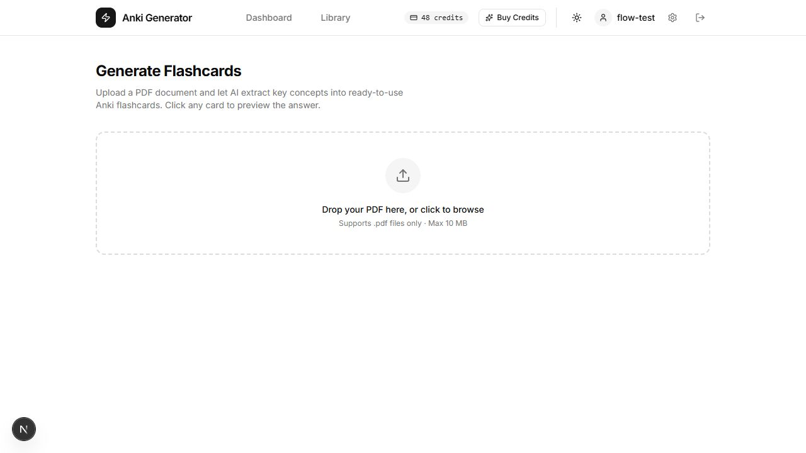
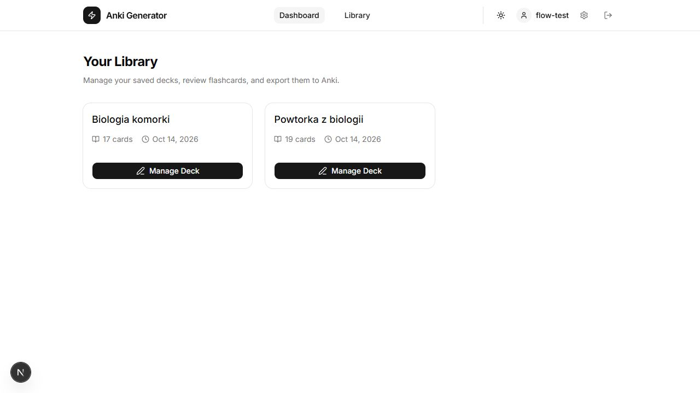
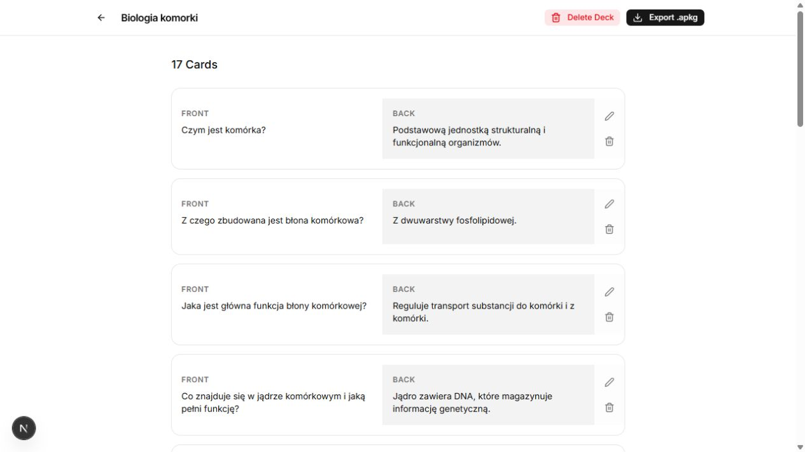

# Anki Generator

Turn PDF study materials into editable flashcards and export them to Anki.

Anki Generator is a full-stack MVP built with Next.js and FastAPI. It extracts
text from PDFs, generates Polish question-and-answer cards with OpenAI, and lets
users review their cards before saving and exporting a deck.

## Features

- PDF upload with a 10 MB limit and OCR fallback for scanned documents.
- AI-generated flashcards with progress shown as document chunks are processed.
- Account registration and JWT authentication with Argon2 password hashing.
- A personal deck library with persistent storage, card editing and deletion.
- Export of saved decks as Anki `.apkg` files.
- Generation credits and optional Stripe checkout, billing portal and webhooks.
- Light and dark themes.

## Screenshots

Screenshots show the running application with sample biology decks and a local
test account. The interface is in English; generated cards are currently in Polish.

### PDF upload



### Saved deck library



### Card review and export



## How it works

1. Register an account and sign in.
2. Upload a PDF. The backend extracts Markdown, falls back to OCR when the
   extracted text is too short, and splits the result into chunks.
3. The frontend requests flashcards for each chunk and displays progress.
   Each successful generation request consumes one credit; new accounts start
   with 50 credits.
4. Preview the generated cards and save the deck to your library.
5. Open the saved deck to edit or delete cards, then export it as `.apkg` for Anki.

## Technology

| Area | Tools |
| --- | --- |
| Frontend | Next.js 16, React 19, TypeScript, Tailwind CSS, shadcn/ui |
| Backend | Python 3.12, FastAPI, SQLAlchemy, Alembic |
| Database | PostgreSQL 16 |
| PDF processing | PyMuPDF, pymupdf4llm, Tesseract OCR |
| Generation and export | OpenAI structured responses, Pydantic, genanki |
| Payments | Stripe |
| Local environment | Docker Compose |

The browser communicates with the FastAPI API. The backend handles PDF
processing, OpenAI requests, authentication and database access. API keys and
database credentials stay on the backend; the frontend only needs the public API URL.

## Run locally

Prerequisites: Git, Docker with Docker Compose, and an OpenAI API key with access
to the model configured in `backend/app/services/ai.py`.

From a PowerShell terminal:

```powershell
git clone https://github.com/jacobdev03/anki-generator.git
cd anki-generator
Copy-Item .env.example .env
```

If `.env` already exists, edit it rather than overwriting it. Replace these placeholders:

| Variable | Purpose |
| --- | --- |
| `DB_PASSWORD` | Password for the local PostgreSQL database; use an alphanumeric or hexadecimal value |
| `OPENAI_API_KEY` | Backend credentials for flashcard generation |
| `JWT_SECRET_KEY` | Random secret used to sign authentication tokens |

Generate a JWT secret with Python, if available:

```powershell
python -c "import secrets; print(secrets.token_hex(32))"
```

Leave the Stripe variables empty to run without payment features. Then start all services:

```powershell
docker compose up --build
```

- Application: <http://localhost:3000>
- Interactive API documentation: <http://localhost:8000/docs>

The backend applies Alembic migrations before starting. PostgreSQL data is stored
in a Docker volume. Stop the services with `docker compose down`.

A real OpenAI key is needed to generate cards. Startup and authentication can
be checked with a placeholder key. Extracted PDF text is sent to OpenAI during
generation; use sample documents when trying the application.

For a frontend started with npm, a Python backend started without Docker,
environment-file details and optional Stripe setup, see
[configuration](CONFIGURATION.md) and [backend instructions](backend/README.md).

## Checks

Frontend checks require Node.js 20.9 or newer:

```powershell
cd frontend
npm ci
npm run lint
npx tsc --noEmit
npm run build
```

Backend migration tests, after installing the backend dependencies:

```powershell
cd backend
python -m unittest discover -s tests -v
```

Migration tests use temporary SQLite databases by default. An optional dedicated
PostgreSQL test database is supported; see [backend tests](backend/README.md#migration-regression-tests).

The basic application flow is covered by Playwright: registration/login, PDF
upload, generation, credit accounting, saving, editing, reopening and APKG export.
The browser tests use a real frontend/backend and a separate temporary SQLite
database, with a controlled AI response instead of paid OpenAI calls.

After installing backend dependencies, from `frontend`:

```powershell
npx playwright install chromium
npm run test:e2e
```

See [browser test setup and coverage](frontend/tests/e2e/README.md) for interpreter
selection, reports and limitations. GitHub Actions runs migration tests, lint,
typechecking and the frontend build/browser tests on pushes to `master`/`main`
and on pull requests. The workflow can also be started manually.

Real AI generation has also been checked manually. APKG package contents are
verified, but import into the Anki desktop application has not yet been tested.

## Current scope

This is a portfolio MVP. The supported upload format is PDF; DOCX, PPTX and
direct text input are not implemented. Generation uses credits, with one credit
consumed per successful text-chunk request.

The export uses basic front/back cards. Dedicated cloze note types and rich
Markdown rendering are not implemented. AI output should be reviewed before use.
The current OCR setup uses Tesseract's default language data.
The fallback checks the extracted text across the whole document; OCR is applied
to all pages only when that text is shorter than 500 meaningful characters.
In mixed text-and-scan PDFs, scanned pages may therefore be missed.

The 10 MB upload limit does not cap the number of pages, processing time or
generation tokens. Further resource limits, PostgreSQL integration coverage and
deployment hardening are next steps before operating the application as a public service.

## Repository layout

```text
backend/
  app/api/endpoints/   Authentication, upload, generation, decks and payments
  app/models/         Database models
  app/services/       PDF processing, AI generation and Anki export
  alembic/            Database migrations
  tests/              Migration regression tests
frontend/
  app/                Landing page, authentication, dashboard and library
  components/         Upload, flashcards and UI components
  lib/api.ts          Typed API client
docs/screenshots/     Application screenshots
CONFIGURATION.md      Environment and startup instructions
docker-compose.yml    Frontend, API and PostgreSQL services
```
